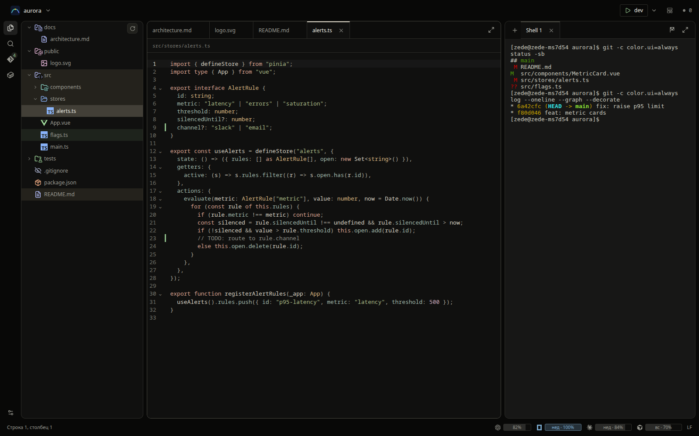
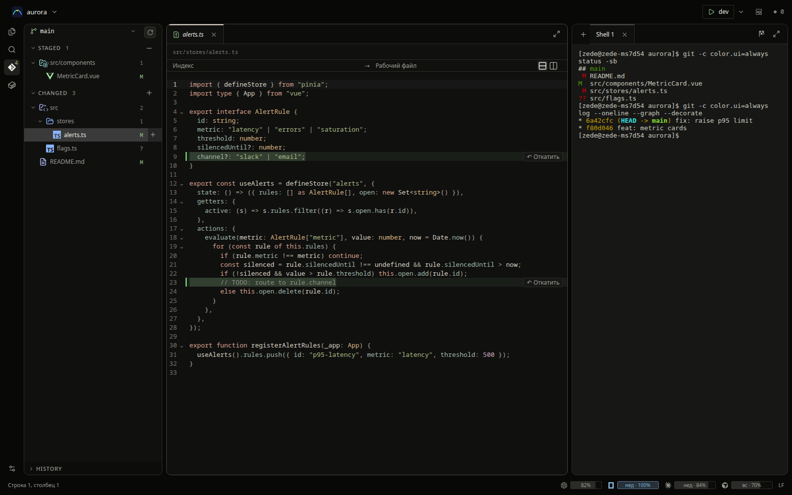
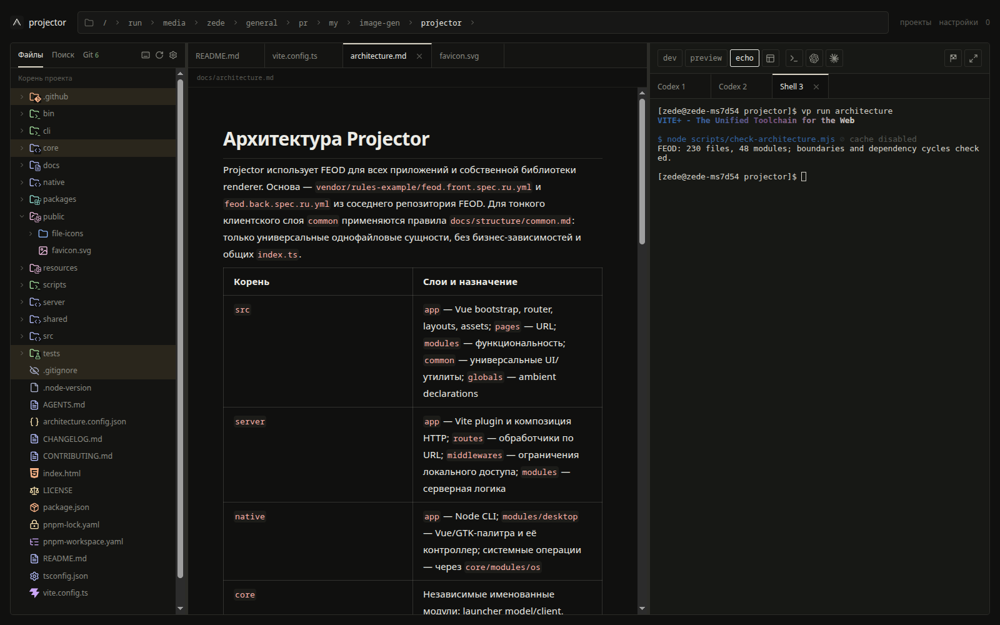
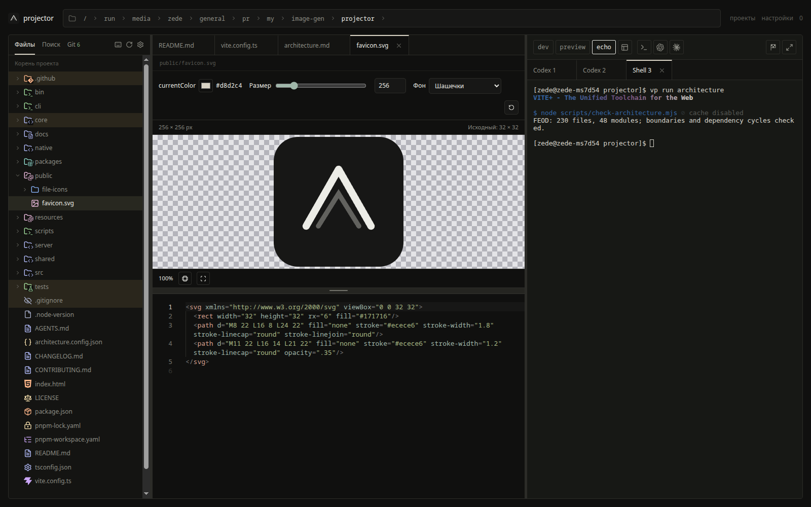
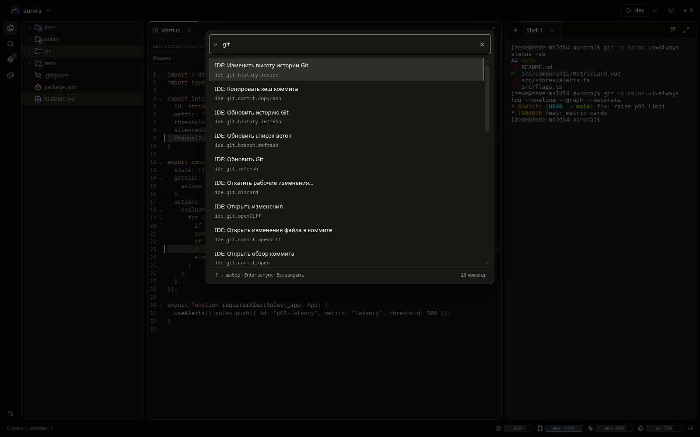
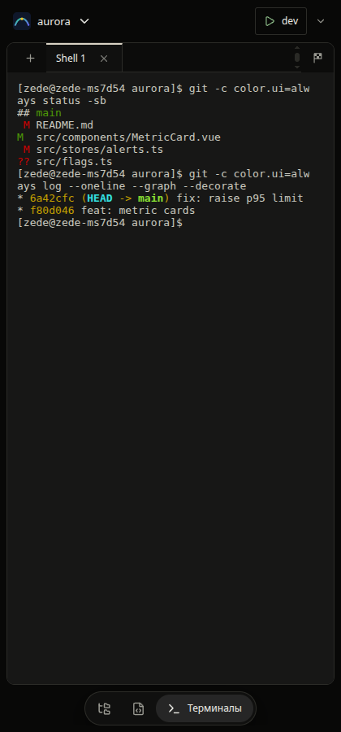

# Projector

Projector — локальное приложение для Linux, Windows и macOS, которое помогает запускать приложения и работать со своими проектами. В одном окне доступны файлы, поиск, Git, редактор Markdown и терминалы. Можно открыть обычный shell или запустить установленные Codex, Claude Code, OpenCode и Cursor.

> Warning! Это личный проект который делается для себя и только под себя. Решаю личные боли и заменяю инструменты которыми мне неудобно пользоваться. Если решитесь поставить, то только на свой страх и риск

<br />

> Info! Это не IDE в привычном виде, это между IDE и ADE, где внимание сосредоточено на просмотре и чтении, а не редактировании кода или оркестрации агентами, а также крайне простой запуск и поддержка проектов без лишней возни и настроек (в процессе)

## Интерфейс



Всё нужное для проекта — в одном окне: дерево файлов, вкладки редактора и терминалы.
Слева рейка панелей (файлы, поиск, Git, Docker), сверху переключатель проектов
и кнопка запуска со сценариями из `package.json`.

### Сильные стороны

**Git без переключения контекста.** Панель показывает staged и изменённые файлы,
ветку и историю. В редакторе открывается diff «индекс → рабочий файл» с откатом
отдельных блоков, а в дереве у файлов стоят метки статуса.



**Чтение важнее правки.** Markdown отображается как документ с таблицами, списками
и цитатами; Ctrl+Shift+M переключает документ и исходник.



**Файлы не «открываются во внешней программе».** SVG показывается рядом с исходником,
с настройкой цвета, размера, фона и масштаба. Иконка проекта подхватывается из его
файлов автоматически.



**Каждое действие — команда.** Ctrl+Shift+P или F1 открывает палитру со всеми
командами `ide.*`, подсказками горячих клавиш и поиском по контексту. Те же команды
видит и выполняет встроенный агент Projector, поэтому всё, что доступно в интерфейсе,
доступно и ему.



**Доступно с телефона.** Включите режим локальной сети в настройках (с необязательным
паролем) — и тот же сервер откроется с телефона с отдельной раскладкой: файлы,
редактор и терминалы переключаются нижней панелью.



**Агенты в графическом чате.** Claude Code, Codex, OpenCode и Cursor можно открыть
не только в терминале, но и в чате с историей, версиями сообщений, откатом файлов,
вопросами агента и прошлыми сессиями (переключатель TUI/GUI). Для проектов в Docker
и Dev Container агенты работают через терминал.

**Встроенный браузер.** Вкладка открывает веб-страницы и dev-серверы проекта рядом с кодом.

Кроме того: терминалы Shell, Codex, Claude Code, OpenCode и Cursor рядом с кодом,
изолированный запуск проектов в Docker, быстрый запуск проектов из GTK-палитры
и один сервер на машину.

## Установка

Projector пока устанавливается из исходников. Проверенное окружение — KDE Plasma с X11; Windows и macOS поддерживаются через адаптеры ОС и проверяются в CI.

Перед установкой понадобятся:

- Node.js 24 и [Vite+](https://viteplus.dev/) с командой `vp` в `PATH`.
- GTK4 и GObject Introspection, включая typelib GioUnix. На macOS: Xcode Command Line Tools (Swift-помощник меню и хоткея) и `brew install gtk4 gobject-introspection pkg-config` (его пробует выполнить `vp run desktop`); без GTK4 нативная палитра недоступна. На Windows GTK4 входит в поставку `node-gtk`.
- Python 3, `make` и компилятор C++ для сборки зависимостей.
- `git`, `rg` (ripgrep) и GNU `mv` для работы с проектами.
- Linux: `xdg-open` для открытия браузера; для режима отдельного веб-окна — Chromium, `xdotool` и `xprop` (X11).

Скачайте выпуск и установите зависимости:

```bash
git clone --branch v0.5.0 https://github.com/Sdju/projector.git
cd projector
vp install --frozen-lockfile
vp run build
./bin/projector
```

Исходники также доступны в [GitHub Releases](https://github.com/Sdju/projector/releases).
Сборка проверяет код и создаёт веб-ресурсы. По умолчанию сервер работает на `vp dev`
из этой папки; `projector mode prod` переключает его на собственный Node-сервер по
собранному `dist`. Отдельного бинарного установщика в версии 0.5.0 нет.

Откроется окно поиска приложений и проектов. Чтобы использовать Projector в обычном браузере:

```bash
./bin/projector --browser
```

На Windows запускайте `bin\projector.cmd`: палитра тоже открывается в GTK-окне.
Веб-интерфейс в браузере:

```bat
bin\projector.cmd --browser
```

Веб-интерфейс доступен по адресу <http://localhost:4177> при работающем Projector.

Чтобы добавить Projector в меню приложений и установить команду `projector`:

```bash
vp run desktop
```

Команда устанавливается в `~/.local/bin`; эта папка должна быть в `PATH`. Сохраняйте папку с исходниками на прежнем месте: установка ссылается на неё. После переноса повторите `vp run desktop`.

## Первые шаги

1. Введите название приложения или проекта в поиске и нажмите Enter.
2. Откройте папку проекта: вставьте путь в строку пути вверху или перетащите папку на окно. Отдельной страницы «Проекты» и формы добавления нет: проект создаётся при первом открытии пути и сразу попадает в поиск. В новом проекте открывается вкладка агента с готовым запросом на инициализацию, отправьте его сами.
3. В проекте слева находятся файлы, поиск и Git, справа — терминалы. Ctrl+D в поиске добавляет приложение или проект в избранное, `gh/` и ссылки github.com открывают репозитории GitHub без клонирования.
4. Откройте Markdown-файл для редактирования. Изменения сохраняются по Ctrl+S и при потере фокуса. Ctrl+Shift+M переключает документ и исходник.

В «Настройках» можно выбрать режим окна и сочетание клавиш. В KDE по умолчанию Ctrl+Alt+Space показывает и скрывает поиск; в других окружениях назначьте сочетание на команду `projector toggle`.

Для терминалов Codex, Claude Code, OpenCode и Cursor соответствующие CLI должны быть заранее установлены и авторизованы (`agent login` для Cursor).

## Запуск и завершение

После установки команды доступны:

```bash
projector toggle     # показать или скрыть поиск
projector --native   # GTK-палитра
projector --window   # отдельное окно Chromium
projector --browser  # открыть в браузере
projector --tray     # запустить в трее без окна поиска
projector --lan | --local   # одноразово: доступ по сети / только localhost
projector mode [dev|prod]   # показать или переключить режим сервера
projector quit       # завершить Projector и запущенные им процессы
```

Для автозапуска добавьте `projector --tray` в настройки автозапуска рабочего окружения. Esc скрывает поиск; выход и перезапуск Projector завершают его терминальные сессии и процессы.

Настройки, избранное и список проектов сохраняются в `~/.local/share/projector` или `$XDG_DATA_HOME/projector`, если эта переменная задана.

Подробнее: [использование](docs/usage.md) и [подключение GitHub](docs/integrations.md). Инструкции для разработки находятся в [AGENTS.md](AGENTS.md).

## Разработка и лицензия

[Правила участия](CONTRIBUTING.md), [UI-кит](docs/ui-kit.md), [изменения в выпусках](CHANGELOG.md).
Projector распространяется по лицензии [MIT](LICENSE). Лицензии включённых
иконок приведены в [NOTICE](public/file-icons/NOTICE.md); пакет `vio` содержит
свой [LICENSE](packages/vio/LICENSE).
