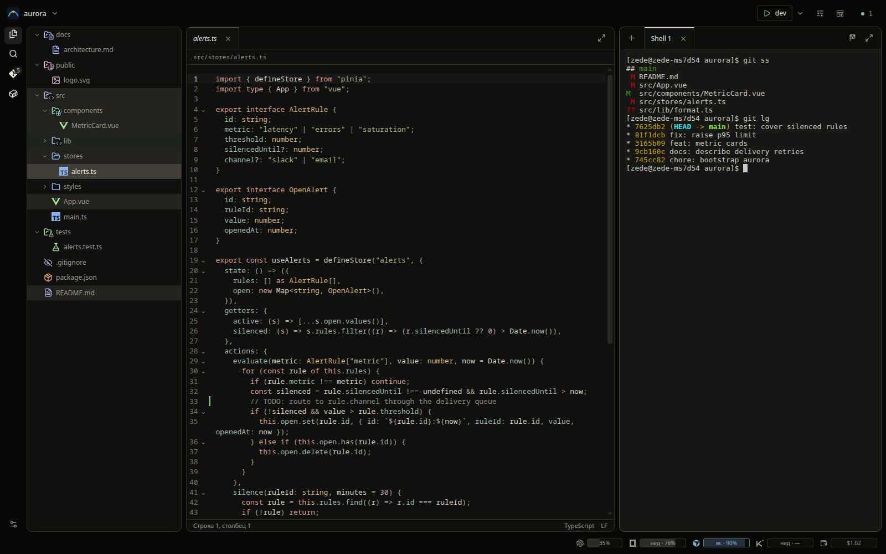
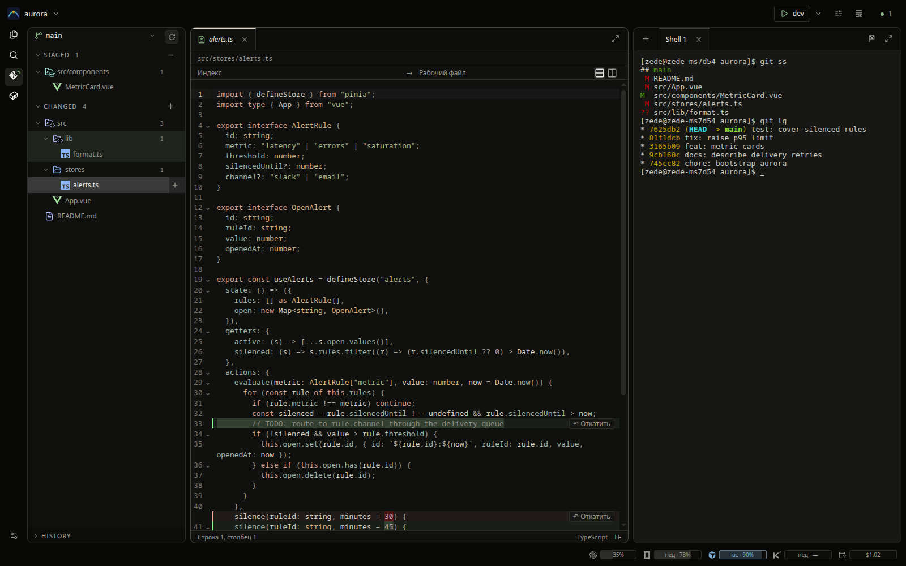
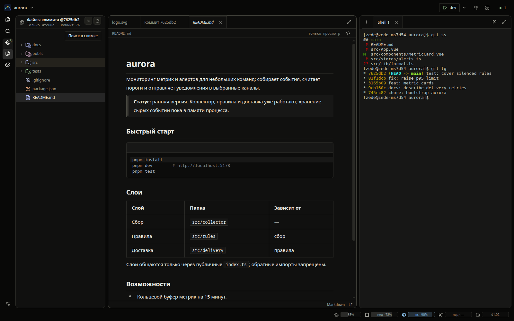
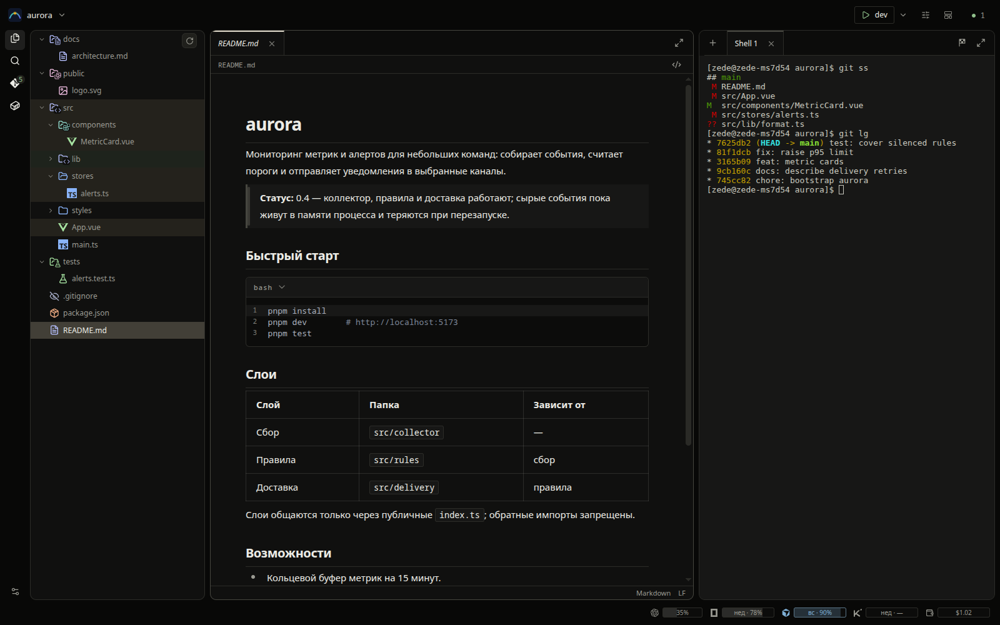
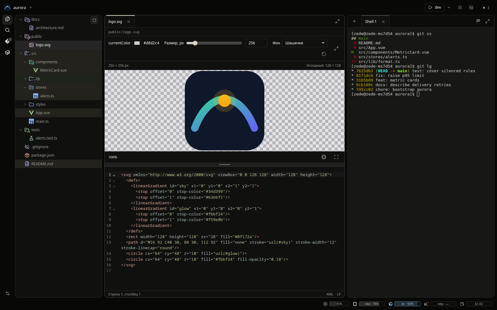
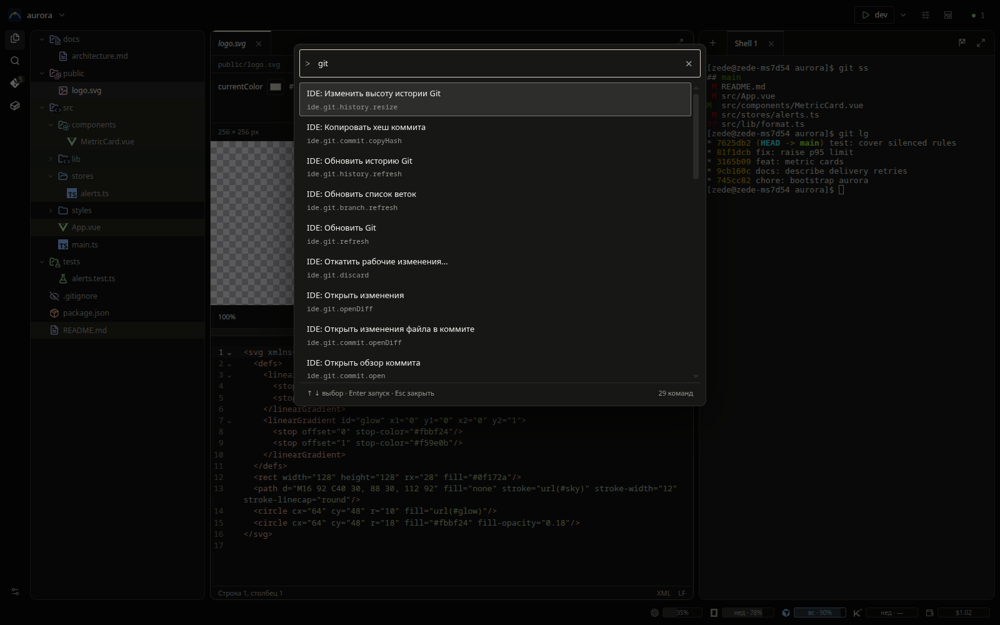
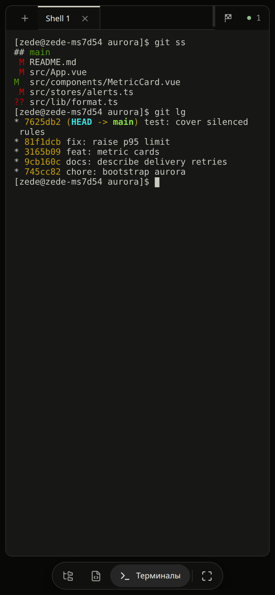

# Projector

Projector — локальное приложение для Linux, Windows и macOS, которое собирает работу над проектом в одном окне: файлы, Git, Markdown, терминалы и графические чаты Codex, Claude Code, OpenCode, Cursor и Kimi Code. Проекты открываются по пути и сразу попадают в поиск, а запуск приложений и проектов с любого экрана остаётся за GTK-палитрой. Один сервер на машину: повторный запуск подхватывает уже работающий процесс.

> Warning! Это личный проект который делается для себя и только под себя. Решаю личные боли и заменяю инструменты которыми мне неудобно пользоваться. Если решитесь поставить, то только на свой страх и риск

<br />

> Info! Это не IDE в привычном виде, это между IDE и ADE. Ставка сделана на чтение, навигацию и запуск: файлы, снимки коммитов, diff, терминалы и агенты. Редактирование кода остаётся агенту или другому редактору.

## Чем Projector отличается

### Агент работает через те же команды, что и палитра

Действия интерфейса зарегистрированы как команды `ide.*` с понятными названиями и горячими клавишами. Ctrl+Shift+P или F1 открывает палитру с поиском по ним. Те же команды видит и выполняет встроенный агент Projector, а внешним агентам они доступны через необязательный MCP-сервер `projector-ide`: `list_commands`, `describe_command`, `execute_command`. Изменяющие команды подтверждаются в окне Projector, поэтому новая кнопка в интерфейсе сразу становится доступной агенту, и наоборот.

### Ответ агента — это интерфейс, а не только текст

В ответ можно вставить `Stat`, `Bars`, `Line`, `Donut`, `Card`, `Columns`, `Tabs`, `Checks`, `Slider` и другие виджеты — сводки, графики и формы собираются прямо в markdown. `<IntelligentForm>` занимает место поля ввода: пользователь заполняет форму на месте чата, а ответ приходит агенту вместе с выбранными значениями. `` и `<Image>` показывают картинки проекта или файла с диска, клик открывает просмотр с масштабом. У Projector виджеты включены по умолчанию, Claude Code, Codex, OpenCode, Cursor и Kimi включают их в настройках или в конкретном чате. Подробнее — [возможности агентов](docs/agent-features.md) и [виджеты](docs/agent-widgets.md).

### Коммит или merge request читается как обычный проект

Понятие снимка (`live`, `commit`, `compare`) задаёт, что именно открыто: рабочая копия, коммит или сравнение. Дерево коммита открывается отдельным разделом «Файлы коммита @hash» в режиме только чтения: те же файлы, поиск, Markdown с картинками, SVG и открытие по ссылкам, но без записи, импорта и наблюдения за диском. Изменённые файлы merge request открываются временной панелью с поиском, статусами и `+/-`, а строки — read-only diff двух снимков. Снимки и их вкладки переживают перезагрузку страницы.

### GitHub и GitLab без клонирования

`gh:/owner/repository` и `gl:/instance/group/project` открывают удалённый проект как локальный: дерево, файлы, Markdown, Issues, Pull/Merge requests, Pipelines с джобами и логами, Releases с ассетами и source archives, историю, коммиты и diff. Публичные репозитории GitHub и GitLab читаются без входа, приватные — по токену из системного хранилища секретов. В локальном проекте с GitHub или GitLab в `origin` те же разделы добавляются к обычным файлам, Git и терминалам. Запись, Git-мутации и запуск кода в удалённых проектах отключены — это read-only клиент. Подробности — [интеграции](docs/integrations.md).

### Браузер с настоящими origin

Встроенный браузер открывает страницу не в `iframe` и не через переписывание JavaScript: каждый сайт получает собственный origin вида `<хост>.<ключ>.proxy.localhost:<порт Projector>`. Поэтому относительные ссылки, `fetch`, `localStorage` и cookies работают как в обычном браузере, а API Projector остаётся на другом origin. Прокси снимает `X-Frame-Options` и CSP и хранит cookies сайтов в своём jar до перезапуска. Всё это доступно только при открытии Projector на этом компьютере; WebSocket и service worker сайта не проксируются.

### Терминалы и агенты живут дольше страницы

Терминал — это PTY в памяти сервера: переключение вкладок и перезагрузка браузера не убивают сессию, а экран, курсор, режимы и 5000 строк восстанавливаются. Вкладки Projector делят соединения через SharedWorker, а при его сбое есть запасной транспорт. Ход агента живёт в отдельном процессе: перезагрузка страницы или перезапуск сервера Projector не прерывают ответ, чат переподключается и получает его с начала. Сюда же относятся фоновые задания с diff и логом, форки чатов, вопросы в сторону `/btw` и живая подпись Lens о том, чем агент занят.

### Один сервер, палитра и телефон

GTK-палитра по хоткею ищет приложения и проекты (в том числе ещё не открытые папки в избранных), открывает пути и репозитории по `gh/`, `gl/` и создаёт или открывает проекты по `new/имя`. Веб-интерфейс использует ту же модель поиска. Режим локальной сети с необязательным паролем открывает тот же сервер с телефона с отдельной раскладкой, а на `localhost` Projector ставится как PWA в отдельное окно. Для внешних программ шлюз `/api/openai/v1` отдаёт OpenAI-совместимые `models`, `chat/completions`, `completions` и `embeddings` со стримингом, ключом и белым списком origin.

## Интерфейс



Всё нужное для проекта — в одном окне: дерево файлов, вкладки редактора и терминалы.
Слева рейка разделов (файлы, поиск, Git, Docker), а у проекта с GitHub или GitLab
в `origin` — ещё Issues, Pull/Merge requests, Discussions, Pipelines и Releases. Сверху
переключатель проектов, сценарии запуска и настройки.

### Git

**Git без переключения контекста.** Панель показывает staged и изменённые файлы,
ветку и историю. В редакторе открывается diff «индекс → рабочий файл» с откатом
отдельных блоков, а в дереве у файлов стоят метки статуса.



**Коммит — это тоже проект.** Любой коммит открывается обзором и целым деревом
в режиме только чтения: файлы, Markdown с картинками, SVG и поиск по снимку.
Рабочая копия при этом остаётся нетронутой.



### Чтение: Markdown и SVG

**Чтение важнее правки.** Markdown отображается как документ с таблицами, списками
и цитатами; Ctrl+Shift+M переключает документ и исходник. Изображения, SVG и HTML
открываются рядом с исходником, а архивы показывают список записей без распаковки.



**Файлы не «открываются во внешней программе».** SVG показывается рядом с исходником,
с настройкой цвета, размера, фона и масштаба. Иконка проекта подхватывается из его
файлов автоматически.



### Команды

**Каждое действие — команда.** Ctrl+Shift+P или F1 открывает палитру со всеми
командами `ide.*`, подсказками горячих клавиш и поиском по контексту. Те же команды
видит и выполняет встроенный агент Projector, поэтому всё, что доступно в интерфейсе,
доступно и ему.



### Агенты

Claude Code, Codex, OpenCode, Cursor и Kimi Code открываются не только в терминале,
но и в графическом чате: история, версии сообщений, откат файлов, вопросы агента,
прошлые сессии и переключатель TUI/GUI. Разрешения оценивает Судья Projector по шкале
риска 1–5; фоновые задания можно проверить по diff и логу, продолжить, влить или
удалить вместе с копией. Для проектов в Docker и Dev Container агенты работают через
терминал.

### Телефон, LAN и PWA

**Доступно с телефона.** Включите режим локальной сети в настройках (с необязательным
паролем) — и тот же сервер откроется с телефона с отдельной раскладкой: файлы,
редактор и терминалы переключаются нижней панелью. С `localhost` Projector ставится
как приложение (PWA) — отдельное окно без браузерной обвязки; в нижней панели есть
полноэкранный режим.



### Docker

Проект можно запускать в изолированном Docker-окружении или Dev Container: команды,
терминалы и клонирование репозиториев выполняются в контейнере, а файлы и Git
остаются доступны в обычном workspace. Подробности — [Docker](docs/docker.md).

## Установка

Projector пока устанавливается из исходников. Проверенное окружение — KDE Plasma с X11; Windows и macOS поддерживаются через адаптеры ОС и проверяются в CI.

Перед установкой понадобятся:

- Node.js 24 и [Vite+](https://viteplus.dev/) с командой `vp` в `PATH`.
- GTK4 и GObject Introspection, включая typelib GioUnix. На macOS: Xcode Command Line Tools (Swift-помощник меню и хоткея) и `brew install gtk4 gobject-introspection pkg-config` (его пробует выполнить `vp run desktop`); без GTK4 нативная палитра недоступна. На Windows GTK4 входит в поставку `node-gtk`.
- Python 3, `make` и компилятор C++ для сборки зависимостей; Python 3 также читает архивы.
- `git`, `rg` (ripgrep) и GNU `mv` для работы с проектами.
- Linux: `xdg-open` для открытия браузера; для режима отдельного веб-окна — Chromium, `xdotool` и `xprop` (X11).

Скачайте выпуск и установите зависимости:

```bash
git clone --branch v0.9.0 https://github.com/Sdju/projector.git
cd projector
vp install --frozen-lockfile
vp run build
./bin/projector
```

Исходники также доступны в [GitHub Releases](https://github.com/Sdju/projector/releases).
Сборка проверяет код и создаёт веб-ресурсы. По умолчанию сервер работает на `vp dev`
из этой папки; `projector mode prod` переключает его на собственный Node-сервер по
собранному `dist`. Отдельного бинарного установщика в версии 0.9.0 нет.

Откроется окно поиска приложений и проектов. Чтобы использовать Projector в обычном браузере:

```bash
./bin/projector --browser
```

На Windows после `vp run desktop` можно запускать Projector из меню Пуск без терминала; из checkout — `bin\projector.cmd`. Палитра открывается в GTK-окне. Веб-интерфейс в браузере:

```bat
bin\projector.cmd --browser
```

Веб-интерфейс доступен по адресу <http://localhost:4177> при работающем Projector.

Чтобы добавить Projector в меню приложений и установить команду `projector`:

```bash
vp run desktop
```

Команда устанавливается в `~/.local/bin` (Windows: `%LOCALAPPDATA%\bin`, каталог добавляется в User PATH). На Linux — пункт `.desktop`, на Windows — ярлык в меню Пуск без окна консоли, на macOS — ещё и `~/Applications/Projector.app` (его находят Spotlight, Raycast и Launchpad; одного CLI недостаточно). Сохраняйте папку с исходниками на прежнем месте: установка ссылается на неё. После переноса повторите `vp run desktop`.

## Первые шаги

1. Введите название приложения или проекта в поиске и нажмите Enter.
2. Откройте папку проекта: вставьте путь в строку пути вверху или перетащите папку на окно. Отдельной страницы «Проекты» и формы добавления нет: проект создаётся при первом открытии пути и сразу попадает в поиск. В новом проекте открывается вкладка агента с готовым запросом на инициализацию, отправьте его сами.
3. В проекте слева находятся файлы, поиск и Git, справа — терминалы. Ctrl+D в поиске добавляет приложение или проект в избранное, `gh/`, `gl/` и ссылки на github.com или gitlab.com открывают репозитории без клонирования, `new/имя` создаёт проект в избранной папке или открывает уже существующую.
4. Откройте Markdown-файл для редактирования. Изменения сохраняются по Ctrl+S и при потере фокуса. Ctrl+Shift+M переключает документ и исходник.

В «Настройках» можно выбрать режим окна и сочетание клавиш. В KDE по умолчанию Ctrl+Alt+Space показывает и скрывает поиск; в других окружениях назначьте сочетание на команду `projector toggle`.

Для терминалов и графических чатов Codex, Claude Code, OpenCode, Cursor и Kimi Code соответствующие CLI должны быть заранее установлены и авторизованы (`agent login` для Cursor).

## Запуск и завершение

После установки команды доступны:

```bash
projector toggle     # показать или скрыть поиск
projector --native   # GTK-палитра
projector --window   # отдельное окно Chromium
projector --browser  # открыть в браузере
projector --tray     # запустить в трее без окна поиска
projector --lan | --local   # одноразово: доступ по сети / только localhost
projector mode [dev|prod]   # показать или переключить режим сервера
projector quit       # завершить Projector и запущенные им процессы
```

Для автозапуска добавьте `projector --tray` в настройки автозапуска рабочего окружения. Esc скрывает поиск; выход и перезапуск Projector завершают его терминальные сессии и процессы.

Настройки, избранное и список проектов сохраняются в `~/.local/share/projector` или `$XDG_DATA_HOME/projector`, если эта переменная задана.

Подробнее: [поведение и ограничения](docs/usage.md) и [интеграции](docs/integrations.md). Инструкции для разработки находятся в [AGENTS.md](AGENTS.md).

## Разработка и лицензия

[Правила участия](CONTRIBUTING.md), [UI-кит](docs/ui-kit.md), [изменения в выпусках](CHANGELOG.md).
Projector распространяется по лицензии [MIT](LICENSE). Лицензии включённых
иконок приведены в [NOTICE](public/file-icons/NOTICE.md); внешний пакет `@zede/vio` распространяется
по собственной [лицензии MIT](https://github.com/Sdju/vio/blob/main/packages/vio/LICENSE).
