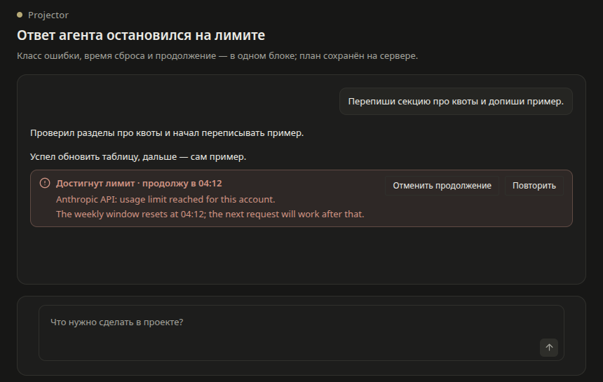
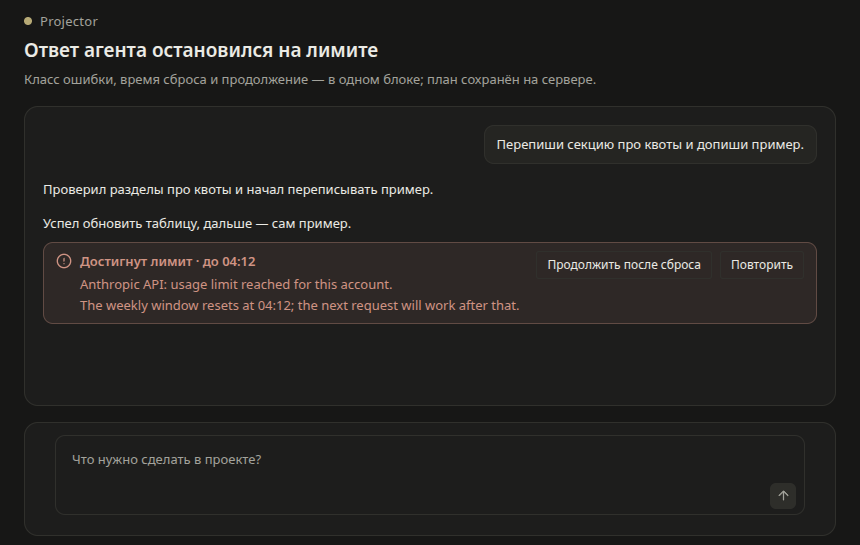

# Ошибки агентов: план реализации

Работа по итогам разбора t3code и Orca: ошибка провайдера становится данными, а не строкой.
Цель — понятный текст без секретов, класс ошибки, `retryable`, время сброса квоты и продолжение
после сброса. Текущее устройство описано в [usage](../usage.md), [заданиях](../agent-jobs.md) и
[возможностях агентов](../agent-features.md); здесь только то, что предстоит сделать.

## Границы

- Не переносим event sourcing, проекции тредов и мобильные приложения.
- Не храним вторую копию переписки: история уже лежит в `agent/history.sqlite`, её и читаем.
- Полная серверная модель чата не нужна: статус добавляется к существующим `LiveRun`/`RecentRun`.
- Смена формата сохранённых данных запрещена: новые поля необязательные, старые читаются как есть.

Изменения в корне, которые требуют отдельного согласования: хранение снимка запроса хода для
headless-продолжения, новая таблица состояния чата, изменение формата `history.sqlite`.
Сейчас план их не требует.

## Этапы

### 1. Контракт ошибки в core

- [x] `packages/core/modules/agent-failure/index.ts`: `AgentFailureClass`, `AgentFailure`,
      `sanitizeFailureText`, `failureFromStatus`, `failureFromText`, `failureTitle`,
      `failureResetFromText`, `isAgentFailure`.
- [x] Тесты `packages/core/tests/agent-failure.test.mjs`: редакция URL/токенов, обрезка,
      статусы 401/403/413/429/5xx, текстовые признаки квоты и обрыва.

Критерий: функции чистые, без Node и без зависимостей от клиента/сервера.

### 2. Классификация на сервере

- [x] `packages/server/modules/agent/failure.ts`: `failureFromError` (AI SDK, сетевые коды),
      `failureFromAcp` (JSON-RPC `error`, stop reason), `failureFromClaudeResult`
      (subtype, `api_error_status`).
- [x] Источники: `ai` `APICallError`, ACP-коды и текст агента, SDK-результат Claude
      (плагин передаёт `status` и `code`).
- [x] Время сброса: `Retry-After`, `(reset after 1h 2m)`, ISO-дата.
- [ ] Лимиты агента (`readAgentUsageLimits`) подключаются на этапе 5 через композицию,
      без цикла `agent` ↔ `agent-usage`.

Критерий: на каждую форму есть тест с реалистичным объектом ошибки.

### 3. Проводка события и хранение

- [x] Событие `error` получает необязательное поле `failure`; строка `error` остаётся.
- [x] `run-request.ts` — единственная точка нормализации для чатовых ходов, включая
      hosted/плагинные ответы (сырой текст не попадает в чат).
- [x] `agent-core/model/turn.ts` и `turn-events.ts` — `failureInfo` у сохранённого хода.
- [x] `jobs-store.ts`, `jobs-live.ts`, `jobs.ts` — `failure` у задания рядом с `error`.
- [x] `recent-runs.ts` — `failure` у завершённого хода, запись с будущим сбросом квоты
      не удаляется суточным `prune`.

Критерий: старые сохранённые чаты и задания открываются без ошибок; новые поля переживают reload.

### 4. UI

- [x] `AgentTurn.vue`: заголовок по классу, текст, «Повторить» только при `retryable`.
- [x] Для `usage_limit` с `resetAt` показывается «Лимит до ЧЧ:ММ».
- [x] Вкладка задания и строка «Работ» показывают класс ошибки, а не только строку.
- [ ] Кнопка «Продолжить после сброса» и автопродолжение — этап 5.

Критерий: ни один экран не печатает сырой stderr; квота отличается от поломки.

### 5. Квота и продолжение

- [x] `RecentRun` получает `failure`; `prune` держит запись с будущим сбросом квоты.
- [x] Сброс берётся из `Retry-After`, текста агента или ISO-даты; лимиты агента — следующий шаг.
- [x] Кнопка «Продолжить после сброса»: план живёт на открытой странице и отменяется новым
      сообщением, остановкой или сменой хода.
- [x] План сохраняется на сервере: `RecentRun.resume`, `POST /api/agent/chat/resume`. После
      перезагрузки страница берёт его из `/api/agent/runs` и снова показывает обратный отсчёт.
- [x] Открытая страница отправляет «продолжай» сама; серверный воркер ждёт 30 секунд после сброса,
      чтобы не отправить второй раз.
- [x] Серверный воркер `chat-resume.ts`: headless-ход без страницы. Сметает планы раз в 30 секунд,
      ждёт 30 секунд после сброса (открытая страница отправляет первой), поднимает ход с approvals,
      вопросами и секретами, пишет результат вместо старой ошибки.
- [x] Новое сообщение в чате отменяет запланированное продолжение и прерывает уже начатый
      headless-ход, чтобы два агента не писали в одну папку.
- [ ] Восстановление headless-хода после рестарта сервера: сейчас процесс живёт, но результат
      никто не записывает, пока чат не откроют заново.
- [ ] При старте сервера ход без живого хоста помечается ошибкой, а не остаётся `running`.

Ограничения текущего воркера:

- Продолжение одноразовое: если после сброса агент снова упёрся в квоту, новый план ставит
  пользователь. Цепочку с ограничением, как в Orca, не делаем.
- Если ни одного окна Projector не открыто и агент просит разрешение, запрос ждёт до двух часов
  и отклоняется. Открытое приложение показывает его в «Работах» и позволяет ответить.
- `recent-runs` хранит план, пока он в будущем, поэтому воркер читает список на 24 часа назад:
  иначе план исчезал бы ровно в момент срабатывания.

Критерий: после сброса квоты чат можно продолжить одной кнопкой; после рестарта статус честный.

### 6. Ретраи ACP

- [ ] Бюджет 10 минут и счётчик попыток; повтор только до первого текста, тула или разрешения.
- [ ] Отмена по «Стоп», новые сообщения не дублируются.

Критерий: ни один повтор не выполняет инструмент дважды.

## Что взято из Orca

Разбор `stably.ai/orca` подтвердил модель и дал четыре правила на будущее:

- **Факты храним, текст не храним.** В журнале лежит `kind` и структурные факты, фразы для
  человека строит клиент. У нас текст уже безопасен, но `failure.class` — тот же принцип.
- **Честная неопределённость.** Отдельно различаются «точно не доставлено» и «неизвестно,
  дошло ли»; повтор не делается при сомнении. Пригодится в этапе 5 для автопродолжения.
- **Приоритет причины.** Более поздняя общая ошибка не должна затирать уже установленную
  (`signed out`, `rate limited`). У нас это обеспечивает один `failure` на ход.
- **Цепочка автопродолжений ограничена** (5 подряд, пауза 60·2ⁿ, отмена переживает рестарт).
  Это ограничение стоит взять в этап 5, когда появится воркер.

## Сделано в первой итерации

- `agent-failure` в core: классы, `sanitizeFailureText`, `failureFromStatus/Text`,
  `failureResetFromText`, `failureTitle`, `isAgentFailure`; 18 тестов.
- Серверная классификация: AI SDK, ACP, Claude SDK; 12 тестов.
- Нормализация в `run-request` для чатов и в `jobs-live` для заданий; `failureInfo` у хода,
  `failure` у задания и записи «недавних».
- UI: заголовок ошибки, время сброса квоты, «Повторить» скрывается только при явном запрете;
  «Работы» и вкладка задания показывают класс.

## Как это выглядит

Демонстрационный ход собран из настоящих компонентов (`AgentTurn`, `AgentComposer`) с подставными
данными: реального вызова провайдера не было.

## Порядок и проверки

1. Этапы 1–2: `vp test related packages/core/modules/agent-failure/index.ts` и серверные тесты.
2. Этап 3: тесты событий и сохранения (`packages/client/tests/agent-failure.cases.mjs`,
   `packages/server/tests/agent-*`).
3. Этап 4: браузерная проверка блока ошибки и вкладки задания.
4. Этап 5: тест воркера на подставных часах, проверка после рестарта.
5. Перед PR: `vp check` по изменённым файлам, затем полный `vp run check`.
